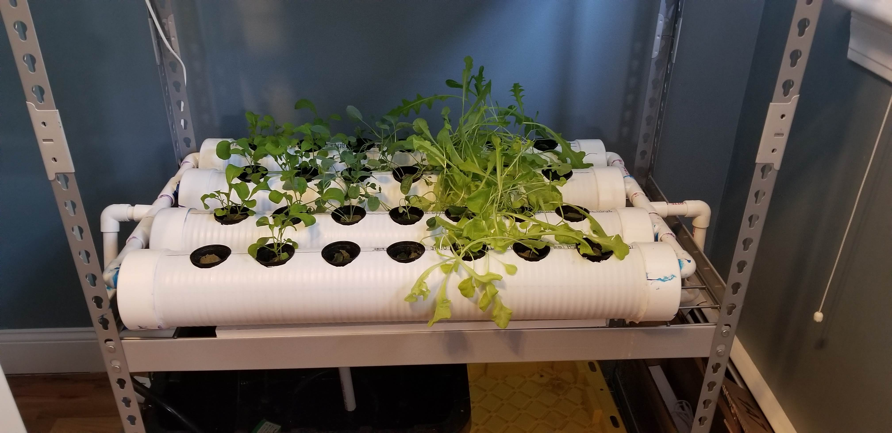
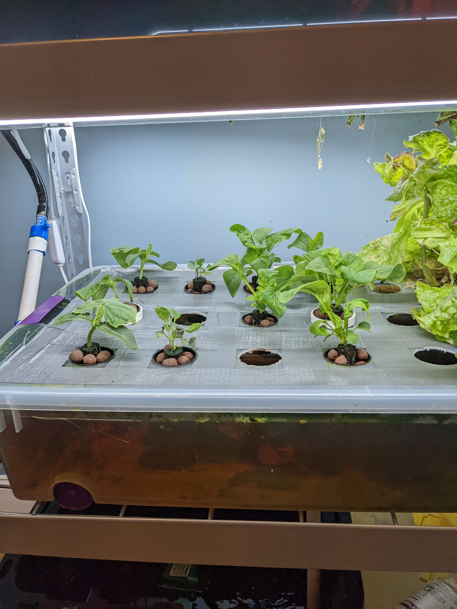
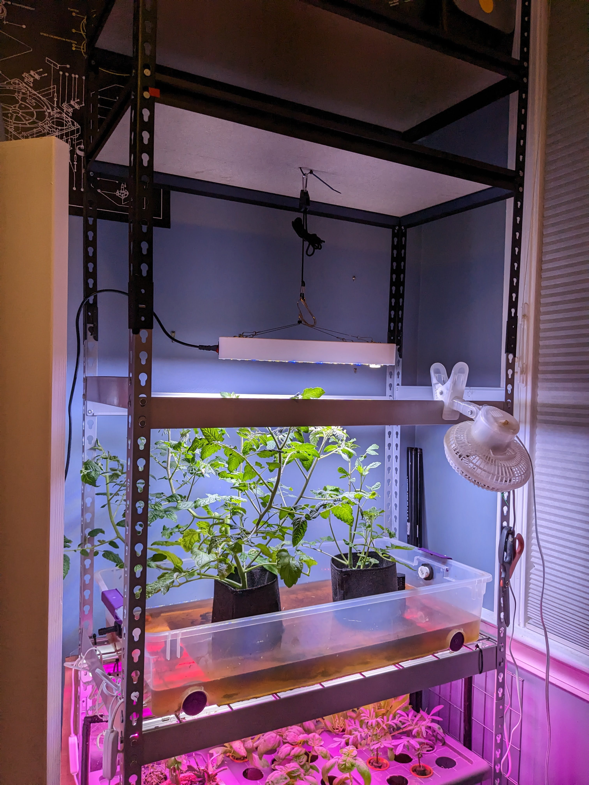

# Hydroponic Setup

## Vision
In 2020 I was living in rural Maine trying to avoid catching Covid 19. To alleviate boredom, my brothers, my girlfriend and I decided to order an Aerogarden to grow some fresh herbs that weren't often in stock at the local grocery store. The Aerogarden became a source of joy for us, bringing flavor, greenery, and light to our kitchen. It didn't take long until we hit the limit of what the Aerogarden could supply. We loved growing lettuce, but it was never enough for a salad to feed four. It would also be nice if we could grow some tomatoes to go in that salad. It would also be nice to enjoy such a salad more often then every 6 weeks.

My youngest brothers Matt and Nick started thinking bigger. How big would a garden need to be to support our needs? The size of a dishwasher? A refrigerator? The naive idea was basically to scale up an Aerogarden and fit it in somewhere so it felt like a built-in part of the house. Fortunately the pandemic began to subside. My brothers went back to school and I moved back to Massachusetts. The dishwasher-scale garden held a place in the back of my mind, but was on-hold for now.

Fast forward two years and I was living in Rhode Island with my now-fiance Fiona. While decorating the new apartment, we realized it could use some plants. Our Ikea budget was maxed out by the time we got to the house plant section, but I remembered the little Aerogarden and dug it up out of a box and set it up. Once again, we quickly hit its maximum capacity. Did we want to grow green onions this month of marigolds? Kale or romaine? It was time to go bigger.

I settled on a 3-foot wide bit of wall space behind the door of the office. This space was too small for a desk, and sat unused despite an otherwise cluttered apartment. There wasn't a lot of depth to work with, but that room had 12 foot tall ceilings and I figured I might as well make the most of that. It was time to answer the question - how much space would it take to fill our vegetable needs?

## Structure
> Note: I've since learned that hydroponic gear usually comes in either 4'x2' or 3'x3' configurations. If you have the space, I recommend using either of these, as 3'x1.5' is non-standard and required a lot more improvisation than it should have.

To make use of the 12 foot ceilings I needed a tall (and also strong) superstructure. I ended up settling on a Husky shelving unit from Home Depot that was 36"x18"x72". Later, I ended up buying a second shelving unit used half of it to perform an illegal double-stacking maneuver. This put the total height at 9 feet. I was debating cutting down the second half of the unit to go all the way to the ceiling, but after I climbed the ladder to measure I realized that 9 feet was plenty tall for me. The nice things about using a metal shelving super-structure was that it was rated to 5000 lbs, far more than I would need. I also chose a shelf with wire-mesh shelves with the idea that a shelf could either be used to support a tray/pots or could be used as a trellis.

## Hydroponic Design

### Nutrient Film Technique
For a hydroponic design, I initially settled on Nutrient Film Technique (NFT) as it was very water-efficient which would keep the weight of the setup near the bottom. The basic design involved 4" PVC pipes running the width of the setup, connected to a source on the left side and a drain on the right. Unfortunately this setup had several problems in implementation, largely caused by my impatience to get growing. First, it turns out it's important to buy the right kind of pipe - I bought a currigated drain pipe, which sealed poorly to the end caps causing issues. Second, I could not find 4" to 3/4" reducers, so I ended up drilling 3/4" holes in 4" end caps. This somehow worked for several grow cycles, but eventually sprung a leak when I bumped into the setup. Finally, this setup turned out to be very difficult to clean when I couldn't get to two sides of the shelf. Eventually I abandoned this configuration in favor of a flood and drain setup.

### NFT Setup

### Flood and Drain
In search of simplicity, I turned to a flood and drain model. To make this work, I needed a tray that fit my shelf space and was around 4" deep. I ended up finding storage trays intended to fit under a bed at Target. These were around 6" deep, and filled a shelf well. Initially, I drilled a hole in each side and used PVC cement to secure the source/drain, and spent far too much time deciding on the relative heights of the source and drain. At the end of the day, this was not a winning strategy. Browsing through my local hydroponics store, I stumbled across ebb & flow bulkhead fittings which greatly simplified the setup. The basic idea with these is to have the source and drain come through the floor of the tray. The drain is elevated using adjustable spacers. This allows you to set and adjust the water level easily. When the pump shuts off, water drains backwards through the pump (this is the step I was missing) allowing the tray to drain fully.

### Flood & Drain Setup

## Water Equipment
I use a Home Depot HDX storage bin (the black and yellow ones) as a reservoir. I started with a 17 gallon, but have since increased to a 24 gallon to feed 2 high-volume storage tray beds. I use a basic Vivosun pump, and an aquarium aerator I found on Amazon to add oxygen and prevent bacteria in the reservoir.

## Nutrients
So far, I have used General Hydroponics for nutrients as they seemed popular, reasonably cost effective, and widely available. I have plans to experiment with some other nutrient solutions in the future though, particularly solutions with fewer components when looking to automate the nutrient feeding system.

## Lighting
I started out by buying a set of 6 LED grow light bars on Amazon. In total these draw 90 watts (15W per light). I still have these in use for my lettuce shelf, and for low-light plants they do quite well. One large advantage of these is that they don't produce much heat, and plants can grow right up to the lights without burning. The one downside of the LED bars I bought is that they produce purple light. While efficient, this isn't great to look at. To ameliorate this, I bought 4 white LED bars. Adding these to the mix means that I can see the color of the plants and the lighting in the office is more pleasant.

Unfortunately, the LED bars are not bright enough for flowering plants. After failed attempts to grow cucumbers, tomatoes and strawberries I decided to buy a brighter (and less purple) light for one shelf. I settled on a KingLED "2000" model on Aliexpress which I found for $110. This light is NOT 2000 watts, but rather 200 watts which they claim is equivalent to a 2000 watt HPS light of years past. So far, the KingLED is bright enough for flowingering plants, and has a pleasant full-spectrum light (though I had to put up a panel to shield from the direct light as it hurts your eyes to look at directly). One weakness of the KingLED is that it doesn't cover the entire 3'x1.5' footprint. It is plenty bright, but I need to give an extra 12-18" of space to let the light spread out so it will get to the plants at the edges. With the brightness of this light, this space may be needed to prevent leaf burning anyways though, so maybe this isn't a real problem.

### Grow Lights
Top shelf is the KingLED, bottom shelf is the purple LED bars.

## Timing and Automation
I started out using a Kasa smart power strip to manage timing. This was cheap and user friendly. The only problem was, it didn't offer a good feature to set up short, repeating timers like 30 minutes on, 30 minutes off for the water pump. At first I used a 3rd party app called IFTTT (if this then that) to turn the pump on/off more rapidly. Unfortunately this would disconnect randomly after a few weeks and cost several lettuce plants their lives. More recently I've added a cheap digital timer specifically for the water pump, but left the grow lights on the Kasa smart switch as it works well for those.
